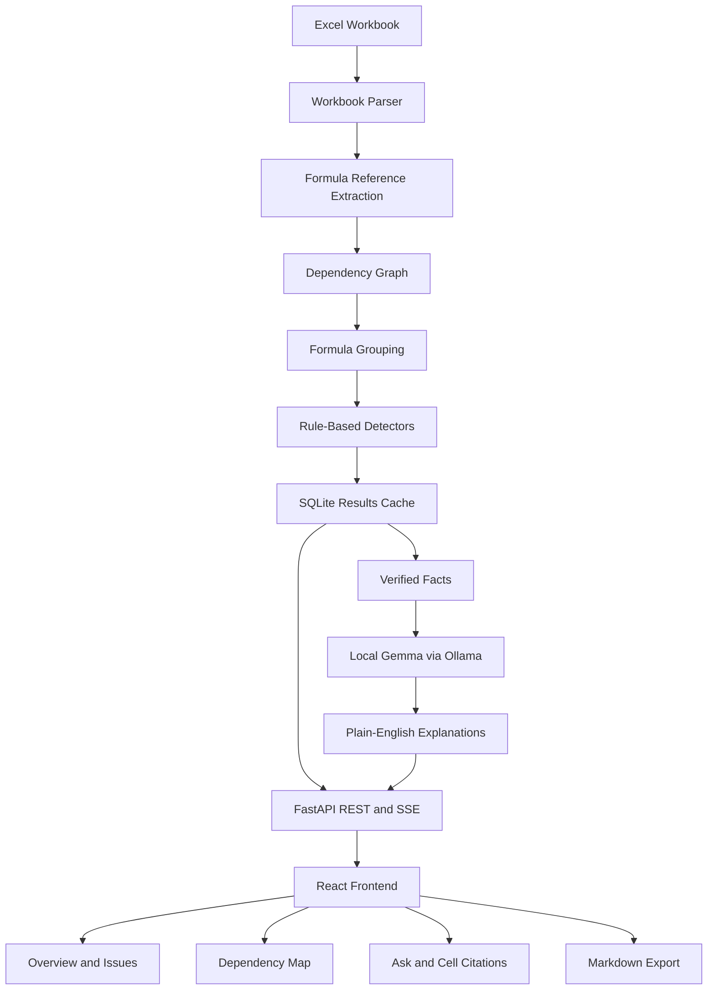

# SheetSense: Spreadsheet Inheritance Translator

SheetSense helps you understand Excel workbooks that someone else created and nobody fully understands anymore.

Think of a file named `pricing_FINAL_v7_use_this_one.xlsx`. The person who built it has left, the formulas have barely been documented, and nobody knows which cells can be safely edited. The spreadsheet still runs the business, so replacing it is not an option.

SheetSense helps you investigate that workbook without having to trace every formula manually.

It generates a plain-English overview of each sheet, flags suspicious cells for review, maps dependencies between sheets, and lets you ask questions about where a number comes from. It also exports a Markdown report that can be used when handing the workbook over to someone else.

**The entire analysis runs locally. Your workbook does not need to be uploaded to an external service.**

**Code finds the facts. A local language model explains them.**

## What SheetSense does

- **Explains your workbook:** Get an overview of each sheet based on its actual structure and contents.
- **Finds suspicious formulas:** Review hardcoded constants, inconsistent formula patterns, potentially incomplete SUM ranges, unused inputs, error values, circular references, and unit mismatches.
- **Maps dependencies:** See how sheets and cells depend on one another.
- **Answers questions:** Ask questions such as "Where does the total with surcharge come from?" and follow the answer through its source cells.
- **Provides cell citations:** Open cited cells directly in the interface. Citations are checked against the dependency chain used to answer the question.
- **Exports a handover report:** Download a Markdown document summarizing the workbook structure and flagged items.
- **Keeps your data local:** Workbook analysis, storage, and model inference run on your machine.

SheetSense is a tool for investigating spreadsheets, not an automated financial auditor. A suspicious formula is something worth checking, not proof that the formula is wrong.

## The problem I wanted to solve

Understanding someone else's spreadsheet can take longer than building your own.

An accountant might inherit a client's financial workbook. A small business owner might need to understand an old pricing model. An operations analyst might be handed a spreadsheet that nobody on the team remembers creating.

The difficult part is not necessarily using Excel. It is figuring out why the workbook works the way it does.

You can compare formulas row by row, trace references across sheets, or ask the original author. But that becomes difficult when a workbook contains thousands of formulas, and the original author may no longer be available.

There is another problem: spreadsheets can produce believable numbers even when a formula is wrong. A missing cell in a SUM range or a hardcoded constant in a repeated formula can go unnoticed for months.

A chatbot can explain an individual formula, but that does not give it the full dependency structure of a large workbook. It also cannot reliably identify every formula that differs from a repeated pattern simply by looking at a few pasted examples.

I built SheetSense to make that investigation more systematic. Instead of asking a model to figure everything out from raw spreadsheet data, the application analyzes the workbook first and uses the model to explain the results.

## How it works

The analysis is split into two phases. This keeps the core analysis independent of the language model.

### 1. Read the workbook

SheetSense uses `openpyxl` to read Excel worksheets, formulas, and available cached values. It validates the workbook before processing it. Legacy `.xls` files can be converted locally when LibreOffice is installed.

Macros are not executed, and `.xlsm` files are rejected.

### 2. Resolve formula references

Formulas are tokenized to identify the cells and ranges they reference, including absolute references and references to other sheets.

This gives the application structured information about how formulas connect to one another.

### 3. Build the dependency graph

Using `networkx`, SheetSense builds a directed graph connecting cells to the cells that depend on them.

The graph supports dependency tracing, cycle detection, and questions about where a value originates.

### 4. Compare formula patterns

Formulas are normalized into relative patterns so that formulas in different rows can be compared.

For example, `=B5*C5` and `=B6*C6` follow the same pattern. If another cell in that sequence uses a different formula structure, SheetSense can flag it for review.

This is more systematic than asking a language model to inspect a handful of formulas and guess whether they are consistent.

### 5. Run rule-based checks

The application uses deterministic Python logic to identify suspicious patterns, including:

- Hardcoded constants inside formulas
- Formula patterns that differ from neighboring formulas
- SUM ranges that might omit relevant data
- Unused inputs
- Spreadsheet error values
- Circular references
- Potential unit mismatches

These findings come from code and predefined rules, not from the language model deciding what looks wrong.

### 6. Generate explanations locally

Once the structural analysis is complete, SheetSense sends small bundles of verified facts to a Gemma model running through Ollama.

The model returns structured explanations that the application can display alongside the underlying evidence. Simple cases can use templates instead of requiring a model call.

If the model fails or is interrupted, the deterministic analysis remains available.

### 7. Answer questions with evidence

When a user asks where a number comes from, SheetSense traces the relevant dependency chain before generating an explanation.

The model receives information about that chain and explains how the referenced cells contribute to the result. Citations are validated against the traced chain, and citations outside it are rejected.

The goal is to make answers easier to verify rather than asking users to trust a generated explanation without evidence.

## Architecture

The project uses a React frontend, a FastAPI backend, SQLite for local storage, and Ollama for local model inference.

### System overview



### Key design decisions

**Deterministic analysis comes first.** Formula parsing, dependency tracing, and suspicious-pattern detection do not depend on an LLM. This makes the core logic easier to test and inspect.

**Model inference is local.** Gemma runs through Ollama, so workbook contents do not need to be sent to a hosted AI provider.

**Analysis and explanations are separate phases.** The application stores deterministic results before generating model explanations. A model failure does not discard the underlying analysis.

**Formulas are read, not executed.** SheetSense does not run spreadsheet formulas or VBA macros. This is important when inspecting workbooks from unknown sources.

**SQLite keeps the setup simple.** It provides persistent storage without requiring users to configure a separate database server.

## Tech stack

| Technology | Purpose |
|---|---|
| Python 3.11+ | Workbook analysis and backend logic |
| FastAPI | Backend API |
| Uvicorn | ASGI server |
| openpyxl | Reading Excel workbooks and formulas |
| networkx | Dependency graph construction and queries |
| SQLAlchemy | Database access |
| SQLite | Local storage and cached results |
| pytest | Backend testing |
| Playwright | Frontend end-to-end testing |
| React 19 | User interface |
| TypeScript | Frontend type safety |
| Vite | Development server and production builds |
| Tailwind CSS | Styling |
| React Router | Frontend navigation |
| TanStack Query | Server state and data fetching |
| xyflow/react | Dependency graph visualization |
| Zustand | Frontend state management |
| Ollama | Local model runtime |
| Gemma | Plain-English explanations |

## Project structure

The repository is divided into a Python backend, a React frontend, tests, and documentation.

```text
Sheet-Sense/
├── backend/
│   ├── .env.example
│   ├── pyproject.toml
│   ├── app/
│   │   ├── main.py
│   │   ├── config.py
│   │   ├── api/
│   │   ├── core/
│   │   │   ├── parser/
│   │   │   ├── graph/
│   │   │   ├── grouping/
│   │   │   ├── detectors.py
│   │   │   └── llm/
│   │   ├── db/
│   │   └── export/
│   └── tests/
├── frontend/
│   ├── package.json
│   ├── vite.config.ts
│   ├── playwright.config.ts
│   └── src/
│       ├── api/
│       ├── components/
│       ├── hooks/
│       └── pages/
├── docs/
│   ├── screenshots/
│   ├── ARCHITECTURE.md
│   └── index.html
├── LICENSE
├── README.md
├── TEST_REPORT.md
└── design.jpg
```

### Where to look in the codebase

| Path | What it contains |
|---|---|
| `backend/app/main.py` | FastAPI entry point, CORS configuration, health check, and router setup |
| `backend/app/config.py` | Application settings, model name, Ollama URL, and data directory |
| `backend/app/api/` | API routes for workbooks, analysis, chat, and exports |
| `backend/app/core/parser/` | Workbook parsing and formula reference extraction |
| `backend/app/core/parser/refs.py` | Cell, range, cross-sheet, and absolute-reference handling |
| `backend/app/core/graph/` | Dependency graph construction and traversal |
| `backend/app/core/grouping/` | Formula normalization and pattern grouping |
| `backend/app/core/detectors.py` | Rules for identifying suspicious cells |
| `backend/app/core/llm/` | Ollama client, explanation prompts, and response handling |
| `backend/app/db/` | SQLite database session and tables |
| `backend/app/export/` | Markdown handover report generation |
| `backend/tests/` | Backend tests, fixtures, and edge cases |
| `frontend/src/api/` | API client and TypeScript types |
| `frontend/src/components/` | Reusable UI components, including the graph and issue views |
| `frontend/src/hooks/` | Workbook and analysis-progress hooks |
| `frontend/src/pages/` | Setup, upload, overview, issues, sheet map, and Ask pages |
| `docs/screenshots/` | Application screenshots |
| `TEST_REPORT.md` | QA test report |

If you want to add a detection rule, start with `backend/app/core/detectors.py`. If you want to change formula tracing, look at the parser and graph modules. For interface changes, start with `frontend/src/pages/` and `frontend/src/components/`.

## Getting started

SheetSense runs locally and requires Python, Node.js, and Ollama.

### Prerequisites

- Python 3.11 or newer
- Node.js 18 or newer
- npm
- [Ollama](https://ollama.com/)
- Enough disk space and available memory for your chosen Gemma model

The example configuration uses `gemma3:4b`, which requires downloading the model before its first use.

### 1. Clone the repository

```bash
git clone https://github.com/PIYUSH-NEXTGEN/Sheet-Sense.git
cd Sheet-Sense
```

### 2. Set up the backend

```bash
cd backend
python -m venv .venv
```

Activate the virtual environment.

**Windows PowerShell**

```powershell
.venv\Scripts\Activate.ps1
```

**macOS or Linux**

```bash
source .venv/bin/activate
```

Install the project and its test dependencies:

```bash
python -m pip install -e ".[test]"
```

### 3. Configure Ollama

Copy the example environment file.

**Windows PowerShell**

```powershell
Copy-Item .env.example .env
```

**macOS or Linux**

```bash
cp .env.example .env
```

Pull the example model:

```bash
ollama pull gemma3:4b
```

Make sure Ollama is running. If it is not already running as a background service, start it with:

```bash
ollama serve
```

Set `MODEL_NAME` in `backend/.env` to the exact model name installed on your machine.

### 4. Start the backend

From the `backend/` directory, with the virtual environment activated:

```bash
python -m uvicorn app.main:app --host 127.0.0.1 --port 8000
```

The backend should now be available at `http://127.0.0.1:8000`.

### 5. Set up the frontend

Open a second terminal from the repository root:

```bash
cd frontend
npm install
npm run dev
```

Open the local address printed by Vite, normally:

`http://localhost:5173`

Use `localhost` for the frontend. The backend's CORS configuration allows that origin.

### 6. Try a workbook

Upload the included sample workbook:

`backend/tests/fixtures/harbor-supply-pricing.xlsx`

Follow the analysis progress and explore the overview, dependency map, issues list, and Ask page. You can also export the results as a Markdown handover document.

To check that the backend is responding, run:

```bash
curl http://127.0.0.1:8000/api/health
```

The response should contain `"backend":"ok"`.

## Using SheetSense

### Workbook overview

Start with the overview to understand the sheets and their relationships before investigating individual formulas.

### Suspicious cells

Review the ranked list of flagged cells. For example, the included sample workbook contains a hardcoded `1.15` in `Summary!B5`, a formula pattern break in `Pricing!C13`, and a potentially short SUM range in `Summary!B3`.

These are examples of findings to investigate, not automatic declarations of errors.

### Dependency map

Use the sheet-level map to understand how data flows between worksheets. It is built from the workbook's formula references rather than generated by the language model.

### Ask a question

Try a question such as:

> Where does the total with surcharge come from?

SheetSense traces the dependency chain, generates an explanation, and provides clickable cell citations to help you verify the answer.

### Export a report

Export the workbook analysis as Markdown. The report can help document an unfamiliar workbook for a colleague, client, or future maintainer.

## Configuration

The backend reads its configuration from `backend/.env`.

| Variable | Required | Default or example | Purpose |
|---|---|---|---|
| `MODEL_NAME` | Yes | `gemma3:4b` | Name of the installed Gemma model |
| `OLLAMA_URL` | No | `http://localhost:11434` | Local Ollama endpoint |
| `LLM_WORKERS` | No | `1` | Number of concurrent explanation workers |
| `DATA_DIR` | No | `~/.sheetsense` | Directory for stored workbooks and cached results |

Keep `LLM_WORKERS` at `1` unless your Ollama server is configured to handle more parallel requests. Increasing the client-side worker count alone may not improve performance.

Do not commit `.env` files or credentials. SheetSense does not require external AI API keys.

## Privacy and security

Privacy was one of the reasons for building SheetSense as a local application.

- **Local processing:** Workbooks are processed and stored on your machine.
- **Local model inference:** Explanations are generated through Ollama on the same machine.
- **No external AI API:** Workbook contents are not sent to a hosted language model.
- **No telemetry or analytics:** The application does not include telemetry or analytics services.
- **No CDN assets:** Frontend JavaScript and CSS are bundled locally, and the application uses system fonts.
- **No macro execution:** VBA macros are not executed, and `.xlsm` files are rejected.
- **Local-only backend:** FastAPI binds to `127.0.0.1`, rather than a public network interface.

The browser communicates with the backend at `http://127.0.0.1:8000`, and the backend communicates with Ollama at `http://localhost:11434`.

The first-time setup requires downloading the repository dependencies and model. Once everything is installed, workbook analysis and inference can run without an internet connection.

Local processing reduces the need to send sensitive workbook data elsewhere, but it does not eliminate every security risk. Keep your machine secure and review any files you choose to analyze.

## Testing

The backend tests cover parsing, reference extraction, graph construction, formula grouping, detection rules, API endpoints, Q&A, and unusual workbook cases.

From `backend/`, run:

```bash
python -m pytest
```

The standard suite uses a mocked language model, so it does not require Ollama to be running.

To run the optional live Ollama test:

```bash
python -m pytest -m ollama
```

This test is skipped unless the required local model service is available.

To build the frontend and run its TypeScript checks:

```bash
cd frontend
npm run build
```

Playwright end-to-end tests are also included in the frontend project.

## Performance

SheetSense does not have formal published benchmarks yet.

During QA, a cold-cache run on the sample workbook took roughly four minutes for about 16 model calls, with CPU-based inference being the main bottleneck. Results are cached in SQLite, making subsequent runs much faster when cached results can be reused.

Template-based explanations and batching also reduce unnecessary model calls.

These measurements come from one machine and one workload. Actual performance will depend on workbook size, available hardware, and the model being used.

## Current limitations

SheetSense is an early release, currently at `v0.1.0`.

Some limitations are worth knowing before using it:

- Suspicious-cell findings require human review and are not proof of errors.
- Model-generated explanations can be imperfect.
- Cached formula values may be unavailable in some workbooks.
- Very large workbooks can take longer to analyze.
- VBA and macro-enabled `.xlsm` files are unsupported.
- Local model inference requires sufficient hardware and disk space.
- The current dependency map is sheet-level. A group-level map toggle is planned but not implemented.
- Desktop packaging and a dedicated workbook handover service are ideas for future development, not existing features.

## Ideas for turning SheetSense into a side hustle

I built SheetSense as a technical project, but I also wanted to explore whether it could solve a problem people would pay to have addressed.

A few possible directions are:

**Workbook handover reports**

Prepare a structured report explaining a workbook's layout, dependencies, and suspicious formulas for accountants, consultants, and small businesses.

**A packaged desktop application**

Offer an easier installation experience for professionals who regularly inherit and review spreadsheets.

**Affordable tools for freelancers**

Provide a focused alternative for people who need help understanding financial or operational workbooks but do not need a full enterprise financial-modelling platform.

The potential value is straightforward. If someone spends hours tracing a workbook or misses a formula issue that affects a business decision, reducing that work could be useful.

These are ideas, not validated business models. I have not established willingness to pay or tested pricing with paying customers. The next step would be to get the tool in front of accountants and small businesses, learn which parts they find useful, and see whether they would pay for them.

## Why open-source AI makes sense here

For SheetSense, the language model is only one part of the application.

The parser, dependency graph, formula grouping, and detection rules do most of the analytical work. The model helps turn the results into explanations that are easier to understand.

That separation makes the project easier to inspect, test, and improve. Developers can work on the analysis without needing a running model for every test, and the model can be changed without rebuilding the workbook-processing pipeline.

It also makes the limitations clearer. A flagged formula still needs to be reviewed, and a generated explanation should be checked against the cited cells.

For a tool that deals with financial and operational spreadsheets, keeping the evidence accessible is more useful than pretending the model will always be right.

## Contributing

Contributions, bug reports, and feature suggestions are welcome.

A few useful places to start:

- Improve or add rules in `backend/app/core/detectors.py`.
- Extend formula parsing and dependency tracing in `backend/app/core/parser/` and `backend/app/core/graph/`.
- Improve explanation prompts and response handling in `backend/app/core/llm/`.
- Work on the interface in `frontend/src/pages/` and `frontend/src/components/`.
- Add tests for edge cases or workbooks that expose incorrect results.

Before submitting a pull request, run the backend tests and build the frontend:

```bash
cd backend
python -m pytest
```

```bash
cd frontend
npm run build
```

For larger changes, opening an issue first is a good way to discuss the approach.

To report a security vulnerability, contact the repository owner privately rather than opening a public issue.


## License

SheetSense is released under the MIT License. See [`LICENSE`](LICENSE) for details.

